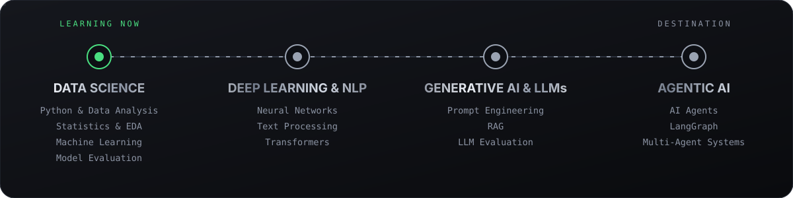
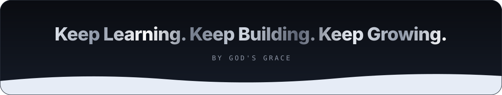

I'm a **Computer Science undergraduate at the University of Delhi**, passionate about exploring how data and artificial intelligence can solve real-world problems.

- 📊 Currently focused on **Data Science and Machine Learning**
- 🧠 Exploring statistical learning, model evaluation and predictive analytics
- 🛠️ Building practical ML projects and experimenting with real-world datasets
- 🤖 Interested in **Generative AI, LLMs, RAG and Agentic AI**
- 🌱 Continuously learning, experimenting and improving through hands-on projects

> **My approach:** Understand the concepts, build from scratch, experiment, and learn from mistakes.

<code>LANGUAGES & DATA</code> 

<code>ML & DEVELOPMENT</code> 

<code>VISUALIZATION</code> 

<code>PLATFORMS</code> 

- 🎯 Build industry-relevant Data Science and ML projects
- 📐 Strengthen my understanding of statistics and model evaluation
- 💼 Gain practical experience through internships
- 🚀 Transition towards Generative AI and Agentic AI
- 🌍 Develop AI applications that solve meaningful problems

I'm always interested in connecting with fellow developers, data enthusiasts and AI learners.

