 

<b>Repositories</b> &nbsp;→&nbsp; <a href="https://github.com/SyrnaxX/credit-risk-analyzer">Credit Risk Analyzer</a> · <a href="https://github.com/SyrnaxX/food-delivery-time-prediction">Food Delivery Time Prediction</a> · <a href="https://github.com/SyrnaxX/spam-detection">Spam Detection</a> · <a href="https://github.com/SyrnaxX/insurance-premium-prediction">Insurance Premium Prediction</a> · <a href="https://github.com/SyrnaxX/car-price-prediction">Car Price Prediction</a>

  

