




<b>🧭 Open the roadmap in detail</b>

- **Now:** Machine Learning, backend with FastAPI, and NLP, learning by building projects.
- **Next:** Deep Learning.
- **Then:** Generative AI (LLMs, RAG, prompt engineering).
- **After that:** Agentic AI (AI agents, LangGraph, multi-agent systems).

<a href="https://github.com/SyrnaxX/credit-risk-analyzer"></a>
<a href="https://github.com/SyrnaxX/food-delivery-time-prediction"></a>
<a href="https://github.com/SyrnaxX/movie-recommender-system"></a>
<a href="https://github.com/SyrnaxX/insurance-premium-prediction-model"></a>
<a href="https://github.com/SyrnaxX/car-price-prediction"></a>

Click any card to open its repository.

<b>📂 Open the project list</b>

| Project | What it does | Stack |
|---|---|---|
| [Credit Risk Analyzer](https://github.com/SyrnaxX/credit-risk-analyzer) | Predicts loan defaults with calibrated XGBoost and explains decisions with SHAP | Python, XGBoost, SHAP, FastAPI |
| [Food Delivery Time Prediction](https://github.com/SyrnaxX/food-delivery-time-prediction) | Predicts delivery times, with strict data-leakage prevention | XGBoost, FastAPI, Docker, Streamlit |
| [Movie Recommendation System](https://github.com/SyrnaxX/movie-recommender-system) | Recommends similar movies, with posters and details from TMDB | TF-IDF, cosine similarity, FastAPI, Streamlit |
| [Insurance Premium Prediction](https://github.com/SyrnaxX/insurance-premium-prediction-model) | Estimates insurance premiums, model served via API | scikit-learn, FastAPI |
| [Car Price Prediction](https://github.com/SyrnaxX/car-price-prediction) | Predicts used-car prices with regression | Random Forest, XGBoost |


<b>🧰 Open the full tech stack</b>

 

<b>Languages & Databases</b> 

<b>Data & Visualization</b> 

<b>Machine Learning</b> 

<b>Backend & Apps</b> 

<b>Tools & Platforms</b> 


